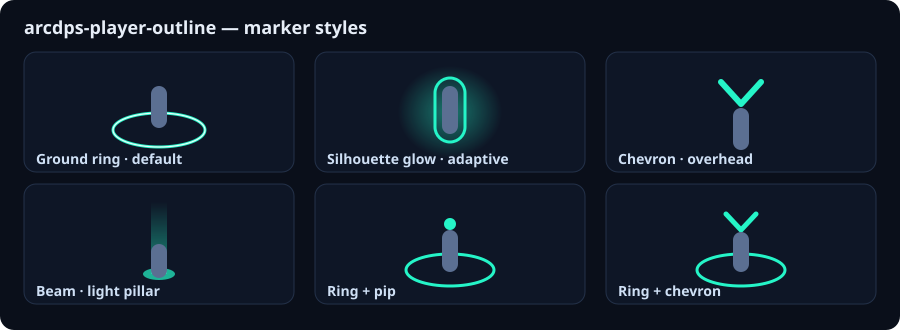
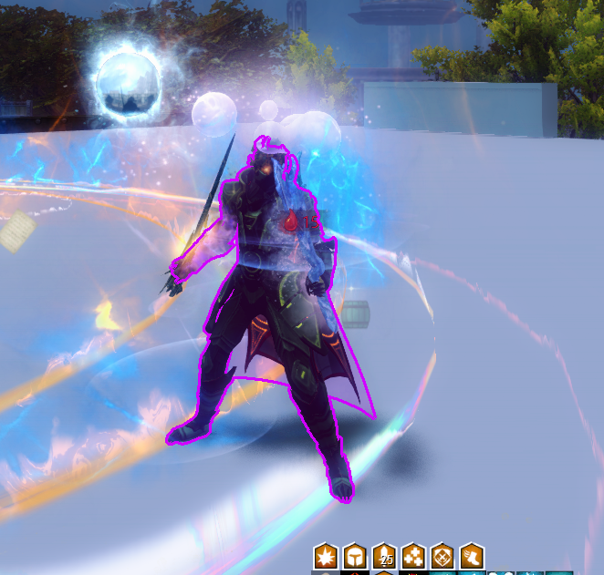
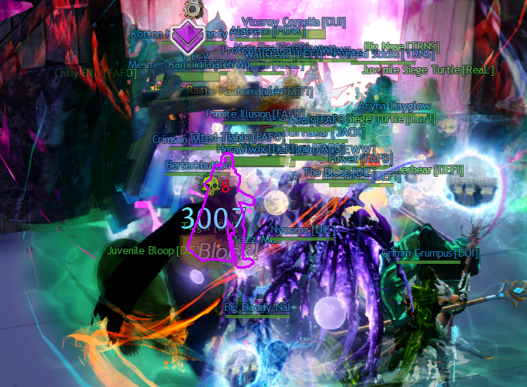

# arcdps-player-outline

[](https://github.com/darkharasho/arcdps-player-outline/actions/workflows/release.yml)

An [arcdps](https://www.deltaconnected.com/arcdps/) plugin for **Guild Wars 2** that draws a persistent, always-on-top marker on **your own character** — so you can instantly find yourself in a crowded zerg. It reads your position from **MumbleLink** and projects it to screen space, tracking smoothly at any camera angle.

It can also draw an experimental **character outline**: a see-through silhouette of your own character model that stays visible through other players (off by default, see [Character outline](#character-outline-experimental)).

It marks *only you*. It does **not** outline other players/NPCs and does **not** show distance to the commander tag (see [Scope & limitations](#scope--limitations)).



<!-- In-game captures: drop your PNGs in docs/images/ and uncomment:


-->

## Features

- **5 marker elements, any combination** — projected ground ring (default; a true floor circle that reads as a circle overhead and an ellipse from the side), adaptive silhouette glow, overhead chevron, light beam and head pip. Each has its own checkbox, so you can stack them (e.g. ring + chevron).
- **Character outline (experimental)** — a see-through silhouette of your own character's body and armour, visible through other players and scenery. Your gear is recognised automatically, with no calibration.
- **Smooth tracking** — [One Euro](https://gery.casiez.net/1euro/) filtering (calm at rest, responsive when moving) with torn-read protection.
- **Configurable outline** — a contrasting border around every element (e.g. blue fill + white outline) so it stays legible on any background.
- **Per-mode toggle** — show the marker in PvE, WvW, or both; structured PvP is always off.
- **Fit height to race** — auto-sizes head-anchored elements to your character's race (so the chevron sits above a Norn's head, not their chest), with an editable per-race height table and a manual nudge.
- **Distance fade** — eases the marker down when the camera is zoomed in close (solo), full when zoomed out (in a pile).
- **Off-screen arrow** — a screen-edge arrow points to you when the camera is turned away.
- **Auto-hide** — hides while the full-screen map is open or the game is alt-tabbed (both toggleable), and respects arcdps's own UI-hide key.
- **Live config** — full options panel (color, opacity, per-element sliders) with settings saved to an ini next to the DLL.
- **Update notice** — the options panel tells you when a newer release is out. It only notifies; it never downloads or installs anything.
- **Cross-platform** — a native Windows DLL that also runs under **Proton/Wine** on Linux.

## Install

You need **arcdps** already installed for GW2. Then:

1. Get `arcdps_player_outline.dll` (build it — see [Building](#building-from-source) — or grab a release if available).
2. Copy it into your GW2 **`addons/`** folder — the same folder that holds your other `arcdps_*.dll` plugins, e.g.:
   - **Windows:** `...\Guild Wars 2\addons\`
   - **Linux/Proton (Steam):** `.../steamapps/common/Guild Wars 2/addons/`
3. **Fully restart** Guild Wars 2 (arcdps loads plugins at launch — a map change won't pick it up).

Open the config with the arcdps options hotkey (default **Alt+Shift+T**) → **Extensions** → **player_outline**.

> **ImGui version must match arcdps.** arcdps silently ignores a plugin whose ImGui version differs from its own. This build vendors ImGui **1.92.7** (`IMGUI_VERSION_NUM 19270`). If a future arcdps update changes ImGui and the marker stops drawing, re-vendor the matching version and rebuild (see below).

### Linux/Proton quick deploy

If you build from source on Linux, `scripts/deploy.sh` copies the DLL into the GW2 addons folder atomically:

```bash
./scripts/deploy.sh
# or point it elsewhere:
PLAYER_OUTLINE_DEPLOY_DEST="/path/to/Guild Wars 2/addons/arcdps_player_outline.dll" ./scripts/deploy.sh
```

## Usage

In the options panel:

- **Check for updates on startup** — once per launch the plugin makes one anonymous request to github.com to see which release is the latest, and shows a notice with the link here if yours is older. Untick it to make no request at all.
- **Show self marker** — master toggle for the marker.
- **Game modes** — show the marker in PvE, WvW, or both.
- **Marker elements** — tick any of Ground ring, Silhouette glow, Overhead chevron, Beam and Head pip. Each enabled element shows its own size/shape sliders.
- **Color / Opacity** and **Outline** (color + width) — shared by all elements; set e.g. a blue marker with a white outline.
- **Fit height to race** — places the pip and chevron by your race's head height, with a per-race table and a nudge for each; untick it to set the heights by hand.
- **Behavior** — distance fade (near/far in meters), the off-screen arrow, and hiding while the map is open or the game is unfocused.

Everything applies live; settings persist to `arcdps_player_outline.ini` on exit.

## Character outline (experimental)

| On your own | In a crowd |
| --- | --- |
|  |  |

Tick **Character outline (experimental)** at the bottom of the options panel. It is off by default and works independently of the marker, so you can run either or both. Like the marker, it is off in structured PvP.

- **Color / thickness / fill** — the outline colour, its width in pixels, and how strongly the inside of the silhouette is tinted.
- **Re-learn my gear** — forgets what it has learned and starts again. Use it if the outline is missing a piece or has picked up something that isn't yours.

**How it learns your gear.** The plugin has to work out which of the game's draw calls are your character. It learns them in the first second or so that **no other player is within a few metres of you**, then outlines only those pieces, which is what keeps it clean inside a stack. If you log in or swap gear while standing in a crowd, the outline stays incomplete until you step clear of other players for a moment.

**Known limits**

- Body and armour only. Weapons are left out, and your mount is not outlined (only the rider).
- A player of the same race standing on your exact spot can get their identical head piece outlined.
- A cape can be cut short while another player wearing the same cape is on screen.
- Gear is re-learned every time the game starts, after every map change and when you switch character.
- A short event log is written to `arcdps_player_outline.log` next to the DLL (overwritten each launch); attach it to bug reports.

> **Use at your own risk.** Unlike the marker, which only reads MumbleLink and draws an overlay, the character outline hooks the game's DirectX 11 draw calls and re-renders your character's meshes. That goes beyond what arcdps addons are clearly allowed to do under ArenaNet's rules. It only ever highlights your own character, but ArenaNet has not approved it and the risk to your account is yours.

## Building from source

The project cross-compiles a Windows x64 DLL from Linux with **MinGW-w64**, and builds a **native** test binary for the platform-independent core (math, projection, filtering, MumbleLink parsing).

**Requirements:** `cmake` (≥ 3.20), `x86_64-w64-mingw32-g++` (MinGW-w64), a host C++17 compiler, `curl` (first build vendors ImGui + doctest).

```bash
# --- native unit tests (host g++) ---
cmake -S . -B build-native
cmake --build build-native
./build-native/core_tests

# --- Windows plugin DLL (MinGW cross-compile) ---
cmake -S . -B build-win -DCMAKE_TOOLCHAIN_FILE=cmake/mingw-w64-x86_64.cmake
cmake --build build-win
# -> build-win/arcdps_player_outline.dll
```

A native Windows build (MSVC/clang-cl) is also possible — the code is standard C++17 + Win32; only the `cmake/mingw-w64-x86_64.cmake` toolchain file is Linux-specific.

## How it works

- **MumbleLink** provides your avatar position, camera position/front/up, and FoV. The plugin reads GW2's live MumbleLink block by scanning its own address space (`VirtualQuery`) — this is required under Proton, where GW2 doesn't expose the block via the named object to an in-process reader. It also creates + holds the named `MumbleLink` section at init so **native Windows** GW2 populates it.
- The pure **core** (`src/core/`) builds a left-handed view/projection from the MumbleLink camera (using the game's real camera-up to avoid gimbal-lock when looking straight down) and projects your world position to screen space. This part is unit-tested.
- The **plugin** (`src/plugin/`) smooths the projected point, then draws the enabled marker elements via arcdps's shared ImGui context.
- The **character outline** (`src/spike/replay_tint.cpp`) hooks the DX11 device context. Each of your character's draw calls is issued a second time with the game's own vertex shader and the plugin's pixel shader, with no depth test, into a mask texture. At present time a full-screen pass draws the edge of that mask. Your draws are told apart from everyone else's by the bone positions in their constant buffers, compared with your MumbleLink position.

## Scope & limitations

- **Self only.** MumbleLink exposes *your* character and camera — nothing about other players. There is no safe (non-memory-reading) API for another player's live world position, so **distance/direction to the commander tag is not possible** in a live overlay. (arcdps only records other players' positions into combat *logs*, after the fact.)
- **The markers are overlays, not model outlines.** Only the experimental [character outline](#character-outline-experimental) follows your character model, and it is a flat 2D silhouette edge rather than true 3D geometry edges.
- **The character outline is experimental.** It depends on details of how GW2 currently renders characters, so a game update can break it. It is developed and tested under Proton with DXVK only.
- **Windows standalone path is untested by the author** (developed/verified under Proton). It follows the documented MumbleLink contract; if the marker doesn't appear on native Windows, that's the first thing to check.

## Credits

- Visual inspiration: the Minecraft [Player-Outline](https://github.com/neilrush/Player-Outline) mod (neilrush).
- Built on [arcdps](https://www.deltaconnected.com/arcdps/) and [Dear ImGui](https://github.com/ocornut/imgui).
- MumbleLink-on-Linux insight from reading how sibling tools locate the block via `/proc`.

## License

[MIT](LICENSE) © 2026 darkharasho.

Vendored dependencies keep their own licenses: [Dear ImGui](https://github.com/ocornut/imgui) (MIT) and [doctest](https://github.com/doctest/doctest) (MIT), both under `third_party/`.
